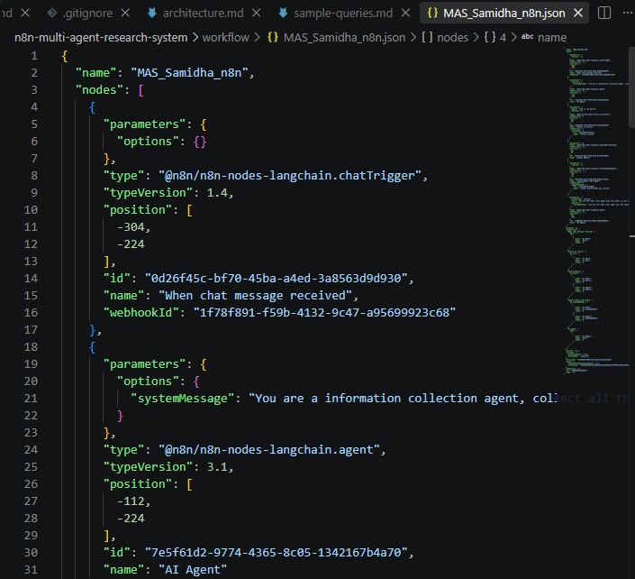

# 🤖 n8n Multi-Agent AI Research System

A multi-agent AI research workflow built with **n8n, Google Gemini, Tavily Search, and conversational memory**.

The system uses multiple AI agents to process user queries, perform web research, and generate context-aware responses.

---

## 🚀 Project Overview

This project demonstrates how multiple AI agents can be orchestrated through n8n to perform research using external web information.

Instead of relying only on an LLM's existing knowledge, the workflow can use **Tavily Search** to retrieve relevant information from the web.

The retrieved information is then processed by the AI agents and used to generate a final response.

### Core Workflow

```text
User Query
     ↓
Chat Trigger
     ↓
AI Agent
     ↓
AI Agent 1
     ↓
Tavily Search
     ↓
Web Information
     ↓
Gemini Processing
     ↓
Final Response
```

---

## 🧠 Architecture

The workflow consists of two AI agents working sequentially.

### AI Agent 1

The first AI Agent receives and processes the user's request before passing the task through the workflow.

### AI Agent 2

The second AI Agent performs additional processing and can use **Tavily Search** to retrieve information from the web.

### Gemini

Google Gemini provides the language model capabilities for understanding queries, reasoning, summarization, and response generation.

### Tavily Search

Tavily provides web search capabilities that allow the workflow to retrieve current external information.

### Simple Memory

Simple Memory maintains conversational context during the interaction.

---

## ✨ Key Features

- 🤖 Multi-Agent AI workflow
- 🔎 Web search using Tavily
- 🧠 Google Gemini-powered AI agents
- 💬 Conversational memory
- 🔄 Sequential agent processing
- ⚡ n8n workflow automation
- 🌐 External information retrieval
- 🧩 Modular AI architecture

---

## 🛠️ Technology Stack

| Technology | Purpose |
|---|---|
| n8n | Workflow orchestration |
| Google Gemini | LLM and AI reasoning |
| Tavily | Web search |
| AI Agent | Task processing and orchestration |
| Simple Memory | Conversation context |
| n8n Chat | User interaction |

---

## 🔄 Workflow

### Step 1 — User Query

The user enters a research question through the n8n chat interface.

```text
User
 ↓
Chat Trigger
```

### Step 2 — AI Agent

The first AI Agent processes the incoming request.

```text
User Query
 ↓
AI Agent
 ↓
Task Processing
```

### Step 3 — Second AI Agent

The processed request is passed to the second AI Agent.

```text
AI Agent
 ↓
AI Agent 1
```

The second agent can use Tavily Search when external web information is required.

### Step 4 — Web Research

Tavily Search retrieves relevant information from the web.

```text
AI Agent 1
     ↓
Tavily Search
     ↓
Web Information
```

### Step 5 — Response Generation

The AI workflow processes the retrieved information and generates a natural-language response.

```text
Retrieved Information
        ↓
Gemini
        ↓
Final Response
```

---

## 📊 System Architecture

```text
                    ┌───────────────┐
                    │  User Query   │
                    └───────┬───────┘
                            │
                            ▼
                    ┌───────────────┐
                    │ Chat Trigger  │
                    └───────┬───────┘
                            │
                            ▼
                    ┌───────────────┐
                    │   AI Agent    │
                    │      #1       │
                    └───────┬───────┘
                            │
                            ▼
                    ┌───────────────┐
                    │   AI Agent    │
                    │      #2       │
                    └───────┬───────┘
                            │
                    ┌───────┴────────┐
                    ▼                ▼
             ┌────────────┐   ┌──────────────┐
             │   Gemini   │   │ Tavily Search│
             │ Chat Model │   │              │
             └────────────┘   └──────┬───────┘
                                     │
                                     ▼
                              Web Information
                                     │
                                     ▼
                              AI Processing
                                     │
                                     ▼
                              Final Answer
```

---

## 💬 Example Queries

```text
Research the latest developments in Agentic AI.
```

```text
Research the major companies working on Generative AI.
```

```text
What are the current trends in supply chain analytics?
```

```text
Research the latest developments in AI automation.
```

```text
Compare the major companies operating in the AI market.
```

```text
Research a company and summarize its products, competitors, and recent developments.
```

---

## 📸 Workflow Screenshots

### Workflow Overview



### AI Agent Architecture


### Chat Demo


---

## 📁 Repository Structure

```text
n8n-multi-agent-research-system/
│
├── README.md
├── .gitignore
├── LICENSE
│
├── workflow/
│   └── multi-agent-research-system.json
│
├── screenshots/
│   ├── workflow-overview.png
│   ├── ai-agent.png
│   └── chat-demo.png
│
├── docs/
│   └── architecture.md
│
└── examples/
    └── sample-queries.md
```

---

## ⚙️ Setup

### Prerequisites

- n8n
- Google Gemini API access
- Tavily API access

### 1. Clone the repository

```bash
git clone https://github.com/samidha2/n8n-multi-agent-research-system
```

### 2. Open the project

```bash
cd n8n-multi-agent-research-system
```

### 3. Import the workflow

Open n8n and import:

```text
workflow/multi-agent-research-system.json
```

### 4. Configure credentials

Configure the required credentials inside n8n:

- Google Gemini
- Tavily

> API keys and credentials are intentionally not included in this repository.

### 5. Execute the workflow

Run the workflow and open the n8n chat interface.

### 6. Submit a research query

Ask a question that requires external information.

---

## 🎯 Concepts Demonstrated

This project demonstrates:

- Generative AI
- AI Agents
- Multi-Agent Systems
- LLM Orchestration
- Web Search
- Information Retrieval
- Conversational Memory
- Prompt Engineering
- Workflow Automation
- Agentic AI

---

## 🔮 Future Enhancements

- Add specialized research agents
- Add source citations
- Add fact verification
- Generate structured research reports
- Export research as PDF
- Add additional search tools
- Add research evaluation metrics
- Add persistent memory
- Add monitoring and logging
- Deploy as a production application

---

## 👩‍💻 Author


Areas of Interest:

- Generative AI
- Agentic AI
- Data Analytics
- Machine Learning
- AI Automation